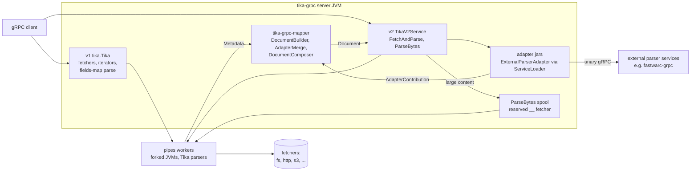
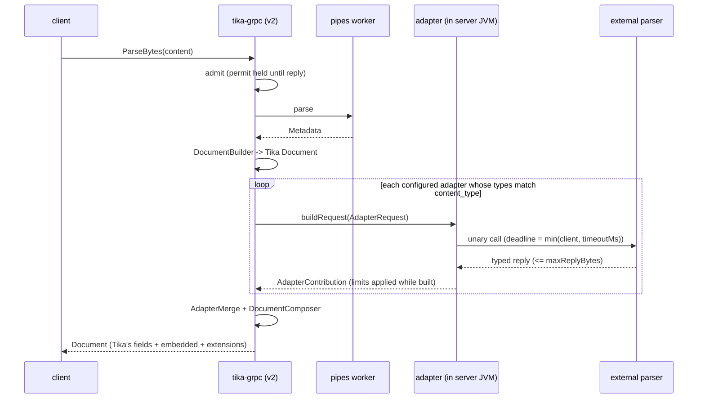

<!--
  Licensed to the Apache Software Foundation (ASF) under one or more
  contributor license agreements.  See the NOTICE file distributed with
  this work for additional information regarding copyright ownership.
  The ASF licenses this file to You under the Apache License, Version 2.0
  (the "License"); you may not use this file except in compliance with
  the License.  You may obtain a copy of the License at

      http://www.apache.org/licenses/LICENSE-2.0

  Unless required by applicable law or agreed to in writing, software
  distributed under the License is distributed on an "AS IS" BASIS,
  WITHOUT WARRANTIES OR CONDITIONS OF ANY KIND, either express or implied.
  See the License for the specific language governing permissions and
  limitations under the License.
-->

# tika-grpc v2 architecture

How the typed Document, ParseBytes and external parser adapters fit together. Each
piece has its own design note with the details:
[v2-document-contract.md](v2-document-contract.md) (TIKA-4766),
[parse-bytes.md](parse-bytes.md) (TIKA-4795) and
[external-parser-adapters.md](external-parser-adapters.md) (TIKA-4771, TIKA-4951).
Settings and defaults are in [the module README](../README.md); the user manual for
external parsers is [external-parsers-manual.md](external-parsers-manual.md).

## Goal

A client indexing documents at scale wants one call per document and one answer it
can use without knowing Tika's internals: typed values, a clear outcome, and the
same shape whatever the format. tika-grpc v2 gives that answer as a `Document`.
It can parse bytes the client already holds, and it can fold in results from
specialised parsers that run outside the JVM, without those parsers ever writing
over what Tika found.

The existing v1 service stays exactly as it is.

## Components



| Module | Holds | Added by |
|---|---|---|
| `tika-grpc-api` | v2 protos and generated classes; what clients depend on | TIKA-4766 |
| `tika-grpc-mapper` | Tika `Metadata` to `Document` (`DocumentBuilder`, transformers); adapter merge and composition | TIKA-4766, TIKA-4771 |
| `tika-grpc-adapter-api` | the adapter SPI: `ExternalParserAdapter`, `AdapterContribution`, `ContributionLimits` | TIKA-4771 |
| `tika-grpc` | v1 and v2 services, ParseBytes admission and spool, adapter loading and calls | all three |
| adapter jar (outside Tika) | a parser's generated stubs plus one adapter, for example FastWARC | per parser |

Parsing always happens in the forked pipes workers, as it does for v1. The server
JVM does admission, mapping, adapter calls and composition. Adapters run in the
server JVM and are trusted code.

## Request flows

### FetchAndParse (v2)

1. The server takes a parse permit, or the call waits for one. A cancelled or
   expired call stops waiting.
2. The fetcher is resolved through one method, `resolveFetcherId` (the single place
   a TIKA-5001 lease will be released).
3. A pipes worker fetches and parses. The server never sees the bytes.
4. `DocumentBuilder` maps the worker's `Metadata` into a `Document`.
5. A document outcome comes back as a Document status. A server outcome (busy,
   failed to start, unknown fetcher) closes the call with a gRPC status.

### ParseBytes

1. Admission: over `parseBytesMaxConcurrent` in progress, or content over
   `parseBytesMaxContentBytes`, is `RESOURCE_EXHAUSTED` before anything is staged.
2. Small content goes to the worker inline. Large content is spooled to a temp file
   that a reserved `__` fetcher reads.
3. The worker parses; `DocumentBuilder` maps the result.
4. ParseBytes fills in what only it can: the SHA-256 and a fallback content type
   when the parse recorded none, and `STATUS_PARTIAL` for content the caller marked
   truncated.
5. The admission permit is held until the reply is sent.

### ParseBytes with external parsers



Adapters run one after another, after Tika's parse. A failed, slow or broken
adapter gives a `STATUS_FAILED` slot; the request still succeeds with Tika's Document
untouched. A client cancel stops the call in progress and skips the rest.

## The Document

```proto
message Document {
  string id = 1;                        // the caller's key
  string content_type = 2;              // Tika-detected
  google.protobuf.Timestamp parsed_at = 4;
  ParseStatus status = 5;               // SUCCESS / PARTIAL / FAILED, raw pipes status, errors
  SourceOrigin origin = 6;              // filename, size, sha256, ParseBytes URIs, truncated
  DocumentMetadata metadata = 20;       // Dublin Core fields, typed
  repeated MetadataField extra = 21;    // every other key, typed where Tika knows the type
  repeated ExtensionResult extensions = 40;  // one slot per external parser
  repeated EmbeddedDocument embedded = 41;   // child documents, e.g. WARC records
}
```

`EmbeddedDocument` carries `path`, `producer_id`, content type, origin, typed
metadata, `extra`, status and errors. It is flat on purpose: no id of its own and no
children. Tika's own embedded documents are not in this list yet; when they are,
they come first under `producer_id` `tika`.

The extracted text is not in the Document yet.

## Who writes what

| Part of the Document | Tika's parse | ParseBytes | an adapter |
|---|---|---|---|
| `id`, `status`, `origin`, `content_type` | yes | fills sha256 / type only when the parse set none; truncation | never |
| `metadata`, `extra` (unprefixed keys) | yes | no | never |
| `extra` keys under the adapter's prefix | no | no | only where Tika set no key of that name |
| `embedded` | not yet | no | its own children, under its `producer_id` |
| `extensions` | no | no | one slot per adapter, written by the server |

Adapter prefixes that overlap a Tika namespace (`tk:`, `X-TIKA`, `dc:`, `Content-`,
`pdf:` and the rest) or each other are refused at startup.

## Outcomes

| Outcome | Where it shows |
|---|---|
| Document parsed, partly parsed, or failed (including timeout, OOM, worker crash) | gRPC OK, `Document.status` |
| No worker free in time, or too many ParseBytes in progress | `RESOURCE_EXHAUSTED` |
| Pipes runtime or fetcher failed to start | `UNAVAILABLE` |
| Unknown fetcher | `NOT_FOUND` |
| Empty ParseBytes content | `INVALID_ARGUMENT` |
| An external parser failed, timed out, was skipped or stopped part way | gRPC OK, its `ExtensionResult.status` |

Errors are one line, at most 1024 characters, unless
`parse-context.exception-reporting` is configured.

## Resources

| Bound | Default |
|---|---|
| ParseBytes content | 256 MiB |
| gRPC inbound message | content limit + 1 MiB |
| ParseBytes in progress | 2 x `pipes.numClients` |
| external reply, per parser | 128 MiB |
| children / embedded bytes, per reply | 100,000 / 64 MiB |
| added by all external parsers together | 96 MiB |
| external call deadline | earlier of the client's and `timeoutMs` (60 s) |

The server warns at startup when the heap or spool space cannot hold
`parseBytesMaxConcurrent` full-size requests.

## Compatibility

`tika.proto` (v1) is byte-identical to main. CI runs `buf lint` on both proto
modules and `buf breaking` against the PR base, so v1 cannot drift. v2 follows buf
STANDARD with no exceptions, and every v2 change so far is additive on the wire.

## How the work lands

| PR | Ticket | Adds | Depends on |
|---|---|---|---|
| apache #2961 | TIKA-4766 | v2 service, Document, mapper, buf CI | main |
| new | TIKA-4795 | ParseBytes | #2961 |
| new | TIKA-4771, TIKA-4951 | adapter SPI, `extensions`, `embedded`, composer | ParseBytes |
| outside Tika | | FastWARC adapter, the working example ([ai-pipestream/tika#6](https://github.com/ai-pipestream/tika/pull/6)) | the SPI |

TIKA-5001 steps 2 and 3 (#3440, #3441) touch the same server class. Fetcher lookup
already goes through one method so a lease fits there.

## Not yet

- The extracted text in the Document.
- Tika's own embedded documents in `Document.embedded`.
- Streaming external parsers (unary only until a need is measured), and streaming
  document events (TIKA-4772).
- Stopping a running parse inside a worker without restarting its JVM.
- An adapter mode that replaces Tika's parse instead of adding to it.
